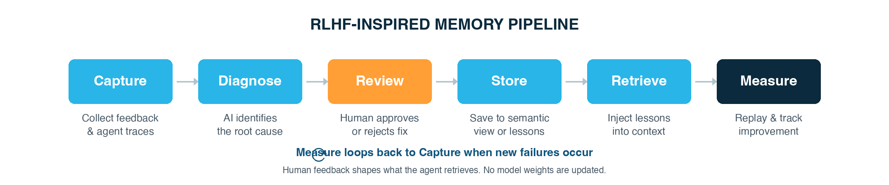

# 🧠 RLHF-Like Long-Term Memory for Cortex Agents

> Turning 👍/👎 feedback from Snowflake Cortex Agents (and CoWork) into **human-approved long-term memory** that the agent retrieves at runtime. There are no weight updates; the agent learns from people through retrieval.

Cortex Agents run on closed-weight models, so you can't post-train them on user feedback. You *can* close the loop at inference time instead:

1. 👎 feedback is captured by the Cortex Agent **Feedback API**
2. 🤖 **AI_COMPLETE** joins it to the full trace and drafts a diagnosis ("case file")
3. 🧑‍⚖️ a **domain owner** reviews, edits and approves it as a *lesson*
4. 🔎 approved lessons are indexed by **Cortex Search**
5. 💡 on every new question the agent retrieves the relevant lessons and follows them

---



## 📊 Results

**Three approved lessons took the agent from 48% to 100% accuracy on 33 new questions, with no regressions and no added latency.**

The eval compares `RLHF_MEMORY_AGENT` against `BASELINE_NO_MEMORY_AGENT`. The baseline is identical (same semantic view, model, and instructions) except it has no `lessons_memory` tool. Every question ran twice per agent, and every answer was graded against ground truth computed in SQL. Grading is strict: only the headline figure counts.

### Realistic mix (33 new questions, none reuse a lesson's wording)

| | ❌ No memory | ✅ With memory |
|---|---|---|
| **Overall accuracy** | 32/66 (**48%**) | 66/66 (**100%**) |
| Questions where a lesson applies | 0/34 (0%) | 34/34 (100%) |
| Questions no lesson applies to (regression check) | 32/32 (100%) | 32/32 (100%) |
| Mean latency | 19.0s | 19.4s |

By lesson: test-order exclusion 0/30 → 30/30, net revenue 0/24 → 24/24, fiscal calendar 0/14 → 14/14.

- **Lessons generalize.** Every question was new, with different periods, regions, categories and metrics (AOV, revenue per unit, top month, top fiscal quarter).
- **No regressions.** On questions no lesson applies to (product/store facts, channel-scoped metrics), the extra context changed nothing.
- **No latency cost.** The added Cortex Search call is within run-to-run noise.

### Targeted set (16 questions built around the traps)

| | ❌ No memory | ✅ With memory |
|---|---|---|
| The lessons' own questions | 0/6 | 6/6 |
| New questions hitting a trap | 4/22 | 22/22 |
| Controls (no trap) | 4/4 | 4/4 |
| **Overall** | 8/32 (**25%**) | 32/32 (**100%**) |

The baseline's 4 "passes" on trap questions were luck: it used the wrong fiscal year but still named the right top category/region.

### ⚖️ Caveats

- Synthetic data with three planted rules. The overall number depends on the question mix; here about half the questions hit a rule.
- This measures whether **approved** lessons fix and generalize. It does not measure how quickly the loop discovers new problems.
- The obvious alternative, hand-writing the same rules into the agent instructions, would likely score the same. The case for memory is that fixes come from user feedback with an owner's approval, and lessons load only when relevant.

### 🔎 Walkthrough example

The original before/after run from the demo, with answers checked against SQL ground truth:

| Question | ❌ Before | ✅ After | 🎯 Ground truth |
|---|---|---|---|
| Total revenue, calendar year 2025 | $4.95M *(gross, test orders included)* | $2,910,668 | $2,910,668 |
| Revenue, Q1 FY2026 | $1.26M *(used Jan–Mar 2026)* | $710,794 *(Feb–Apr 2025, net)* | $710,794 |
| Orders in 2025 | 11,450 *(test orders included)* | 10,891 | 10,891 |
| 🆕 West region sales, Q3 FY2026 | — | $215,029 | $215,029 |
| 🆕 Footwear orders, FY2026 | — | 2,705 | 2,705 |

The two 🆕 questions each needed **two lessons combined**, which shows the memory generalizes beyond the exact question that got the 👎.

---

## 🏗️ Architecture

```
 ┌───────────────────────────── 1. CAPTURE ─────────────────────────────┐
 │                                                                      │
 │  User in CoWork ──asks──▶ Cortex Agent ──answers──▶ User 👍/👎       │
 │                               │                       + comment      │
 │                               ▼                           ▼          │
 │        ┌─────────────────────────────────────────────────────────┐   │
 │        │        SNOWFLAKE.LOCAL.AI_OBSERVABILITY_EVENTS          │   │
 │        │                                                         │   │
 │        │  Trace spans (per turn)        CORTEX_AGENT_FEEDBACK    │   │
 │        │  question · planning ·   ◀──── positive · message ·     │   │
 │        │  tool calls · SQL ·      join  categories ·             │   │
 │        │  results · answer        on    orig_request_id ·        │   │
 │        │                          req   thread_id                │   │
 │        └────────────────────────────┬────────────────────────────┘   │
 └─────────────────────────────────────┼────────────────────────────────┘
                                       ▼
 ┌──────────────────────── 2. DIAGNOSE (AI_COMPLETE) ───────────────────┐
 │                                                                      │
 │   👎 feedback + full trace ──▶ AI_COMPLETE "case file":              │
 │      • What happened   (summed GROSS_REVENUE for Q3)                 │
 │      • Likely issue    (user meant NET_REVENUE)                      │
 │      • Proposed fix    (default revenue → NET_REVENUE)               │
 │      • Suggested tier  (Tier 1 promote / Tier 2 memory)              │
 │      • Confidence + open questions                                   │
 └─────────────────────────────────────┬────────────────────────────────┘
                                       ▼
 ┌─────────────────────────── 3. REVIEW (human gate) ───────────────────┐
 │                                                                      │
 │   Routed by agent / semantic view                                    │
 │                ▼                                                     │
 │   ┌──────────────────────────────┐    ┌───────────────────────────┐  │
 │   │ Domain owner / data steward  │    │ Snowflake admin           │  │
 │   │ judges correctness:          │    │ governs the process:      │  │
 │   │ approve · edit · discard ·   │    │ access, unredacted grants,│  │
 │   │ choose tier                  │    │ approvals, retire stale   │  │
 │   └───────┬──────────────┬───────┘    └───────────────────────────┘  │
 └───────────┼──────────────┼───────────────────────────────────────────┘
   recurring │              │ long-tail /
  structural │              │ situational
 ┌───────────┼──── 4. STORE ┼───────────────────────────────────────────┐
 │           ▼              ▼                                           │
 │  ┌─────────────────────────┐   ┌─────────────────────────────────┐   │
 │  │ TIER 1: Source of truth │   │ TIER 2: Lesson memory           │   │
 │  │ Semantic View metrics,  │   │ LESSONS table → Cortex Search   │   │
 │  │ VQRs, synonyms,         │   │ (approved only, scoped,         │   │
 │  │ agent instructions      │   │  access-filtered)               │   │
 │  │ → always applied        │   │ → retrieved when relevant       │   │
 │  └────────────┬────────────┘   └────────────────┬────────────────┘   │
 └───────────────┼─────────────────────────────────┼────────────────────┘
                 │                                 │
 ┌───────────────┼────────── 5. RUNTIME ───────────┼────────────────────┐
 │               │                                 │                    │
 │  New question ┼──────────▶ retrieve top 3–5 similar lessons          │
 │               ▼                                 ▼                    │
 │      ┌───────────────────────────────────────────────────────┐       │
 │      │ Agent context = instructions + semantic view          │       │
 │      │               + relevant lessons + user question      │       │
 │      └──────────────────────────┬────────────────────────────┘       │
 │                                 ▼                                    │
 │                         Better answer ──▶ new 👍/👎 ──┐              │
 └───────────────────────────────────────────────────────┼──────────────┘
                                                         │
                 ◀────────── loops back to 1. CAPTURE ───┘

 ┌──────────────────────────── 6. MEASURE ──────────────────────────────┐
 │  Eval set of past 👎 questions → rerun before/after → % now correct  │
 │  (Cortex Agent Evaluations)                                          │
 └──────────────────────────────────────────────────────────────────────┘
```

### 🔁 How it maps to RLHF

| RLHF | This design |
|---|---|
| Human preference labels | 👍/👎 + admin curation |
| Reward model | Admin judgment, with AI_COMPLETE drafting each lesson |
| Weight update | Tier 1: permanent edits to semantic views / instructions |
| Policy behavior at inference | Tier 2: lessons retrieved into the prompt |
| Eval | Re-running past failed questions before vs. after |

### 🗄️ Data flow & permissions

```
AI_OBSERVABILITY_EVENTS ──▶ REVIEW_QUEUE (AI_COMPLETE case files, pending)
     (immutable, raw)             │  reviewer approves/edits
                                  ▼
                            LESSONS (approved only) ──▶ Cortex Search
```

| Role | Access |
|---|---|
| 👥 CoWork users | Only USAGE on the Cortex Search service (and the agent). No read or write on the LESSONS table. |
| 🧑‍⚖️ Reviewers (domain owners) | Write access to the review queue and LESSONS, ideally only for their own domain. |
| 🛠️ Pipeline / admin | MONITOR on the agent and the unredacted-read grant to pull traces; owns the tables and the search service. |

LESSONS holds only sanitized guidance, never raw query results, so nothing sensitive from one user's trace gets retrieved into another user's context.

---

## 🪤 The experiment: planted traps

A retail dataset (20k orders, 10 stores, 12 products) with three ambiguities a naive semantic view gets wrong:

| Trap | Naive behavior | Business truth |
|---|---|---|
| 💰 Revenue | `total_revenue = SUM(gross_amount)` | Net = gross − discounts − returns |
| 📅 Fiscal calendar | Q1 = Jan–Mar | FY starts **Feb 1** and is named by its end year (FY2026 = Feb 2025–Jan 2026) |
| 🧪 Test orders | All rows counted | `channel = 'INTERNAL'` rows are test orders and are excluded |

The 👎 feedback was deliberately terse, the way real users write it:

- *"Wrong numbers. Revenue should be net, finance never reports gross."*
- *"That's not our Q1. Our fiscal year starts in February."*
- *"Order count looks too high"* ← intentionally vague

---

## 🔍 Key findings

- 🤖 **AI_COMPLETE didn't invent business rules.** For the vague order-count complaint it flagged *"test orders, specific channels"* as an open question for the owner rather than asserting a rule. The reviewer supplied the `INTERNAL` fact, which supports keeping a human in the loop.
- ✍️ **The reviewer edits drafts; they aren't rubber stamps.** For the fiscal case AI_COMPLETE proposed "ask the user about the fiscal year." Once the owner confirmed the calendar, the reviewer replaced that with the actual rule.
- 🎯 **Retrieval generalizes.** *"How much did the West region sell last fiscal quarter"* ranked the fiscal and revenue lessons at the top, though neither was written for that question.
- 🔗 **The feedback event is thin; the trace is rich.** Feedback joins to the full trace on `RECORD_ATTRIBUTES:"ai.observability.record_id"`, which gives you the question, answer, SQL and results.

---

## 🧱 Snowflake objects

All objects are in `HAEBI_DEMO.RLHF_MEMORY`:

| Object | Type | Purpose |
|---|---|---|
| `ORDERS`, `STORES`, `PRODUCTS`, `FISCAL_CALENDAR` | Tables | Dummy retail data with planted traps |
| `RETAIL_SALES_SV` | Semantic view | Deliberately naive baseline |
| `RLHF_MEMORY_AGENT` | Cortex Agent | Tools: `query_sales` (Analyst) + `lessons_memory` (Search) |
| `BASELINE_NO_MEMORY_AGENT` | Cortex Agent | Eval baseline: same spec without `lessons_memory` |
| `FEEDBACK_WITH_TRACE` | View | Joins feedback events to trace spans |
| `REVIEW_QUEUE` | Table | AI_COMPLETE case files awaiting review |
| `LESSONS` | Table | Approved long-term memory |
| `LESSONS_SEARCH` | Cortex Search service | Indexes approved lessons for retrieval |

---

## 📁 Repo contents

| File | What it is |
|---|---|
| `agent_client.py` | Minimal REST client: `run` (agent `:run`) and `feedback` (agent `:feedback`) |
| `baseline_feedback.json` | The three 👎 submissions |
| `baseline_runs.json` | Answers before memory, with request IDs and SQL |
| `after_runs.json` | Answers after memory |
| `versions/*/agent_spec.json` | Agent specification |
| `eval/run_eval.py` | Memory vs. no-memory accuracy eval (`targeted` and `realistic` suites) |
| `eval/results_*.json` | Every answer, headline, grade and latency from the eval runs |
| `eval/baseline_agent_spec.json` | Spec for `BASELINE_NO_MEMORY_AGENT` |
| `assets/rlhf_memory_pipeline.png` | Pipeline diagram |

### ▶️ Usage

```bash
# Ask the agent questions (captures request_id, SQL, answer)
python agent_client.py --connection <conn> run --question "What was revenue in Q1 of fiscal year 2026?" --out runs.json

# Submit thumbs up/down feedback, the same API CoWork uses
python agent_client.py --connection <conn> feedback --file baseline_feedback.json

# Run the accuracy eval (connection's password must be a PAT)
python eval/run_eval.py --suite realistic --runs 2 --connection <conn>

# Re-score saved answers without calling the agents
python eval/run_eval.py --regrade eval/results_realistic.json
```

---

## ⚠️ Gotchas

- 🌐 **Underscore in the account hostname** fails TLS checks on REST calls. Replace `_` with `-` in the host.
- 📭 **The Feedback API returns an empty body** on success (HTTP 200). Don't parse it as JSON.
- 🔄 **AI_COMPLETE with structured output can return NULL intermittently.** Retry anything still NULL; `SNOWFLAKE.CORTEX.COMPLETE` raises errors instead, which helps debugging.
- 🔐 Reading full trace text requires the `READ UNREDACTED AI OBSERVABILITY EVENTS TABLE` account privilege plus MONITOR on the agent.

---

## 🚀 Next steps

- 📏 Port the eval to a formal **Cortex Agent Evaluation**
- 🧪 Add a **held-out trap** with no lesson, then run it through the full loop (feedback → diagnose → approve) and show it get fixed
- 🆚 Compare against putting the same rules directly in the agent instructions
- ⬆️ Demo a **Tier 1 promotion**: move the net-revenue lesson into the semantic view itself
- 🗓️ Schedule the diagnose step with a **task** so new 👎 feedback flows into the review queue automatically
